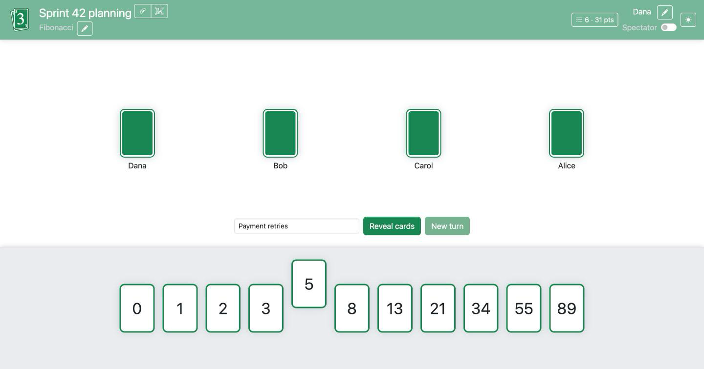
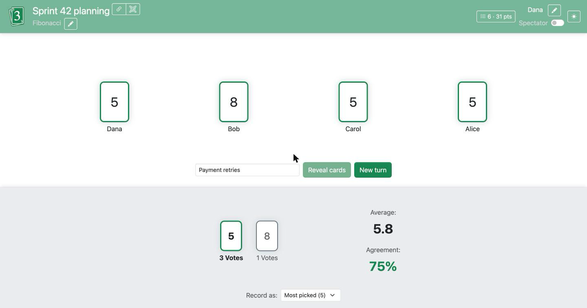
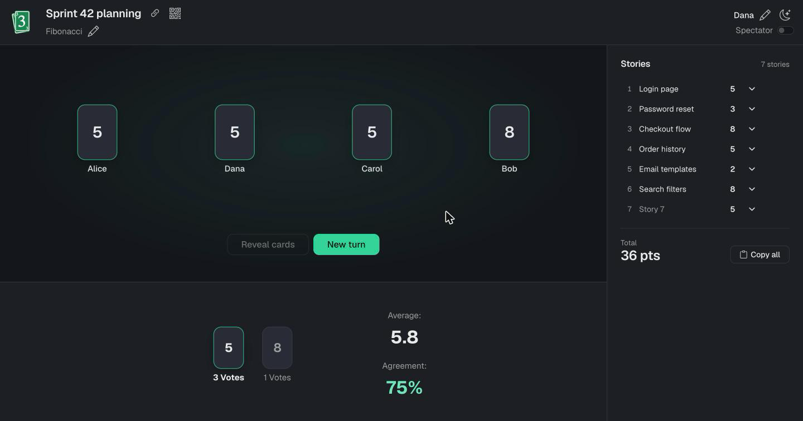

# Self-host Planning Poker

A hassle-free Planning Poker application to deploy on your NAS.

> **Fork notice:** this is a maintained fork of [axeleroy/self-host-planning-poker](https://github.com/axeleroy/self-host-planning-poker), which has been archived.
> It updates the dependencies to their latest versions (Angular 22, Flask 3, Python 3.13) and adds a dark theme and a
> per-estimate story counter. Many thanks to [Axel Leroy](https://github.com/axeleroy) for the original project (MIT license).

[](https://github.com/JustRixter/self-host-planning-poker/commits/main)
[](https://github.com/JustRixter/self-host-planning-poker/blob/main/LICENSE)
[](https://github.com/JustRixter/self-host-planning-poker/actions/workflows/tests.yml)
[](https://github.com/JustRixter/self-host-planning-poker/actions/workflows/publish.yml)

## What is it?

This application is intended as a simplified and self-hostable alternative to
[Planning Poker Online](https://planningpokeronline.com/).

It features:

  * Multiple deck types: Fibonacci, modified Fibonacci, T-Shirt sizes, powers of 2 and trust vote (0 to 5)
  * Spectator mode
  * Responsive layout
  * Vote summary
  * Light and dark themes (follows your system by default, switchable from the navigation bar)
  * Story names: give the story being estimated a name, shared with all the players
  * Backlog: the stories to estimate, in order ("Next up"). Add them one per line (`ABC-123 Login timeout`, a link to
    the issue works too), reorder, rename or skip them, or let an [AI agent](#ai-agents-mcp) fill the
    backlog from your issue tracker. The next story is shown above the table, and revealing the cards estimates it.
  * Estimated stories: a list that is always visible next to the game (below it on small screens). A story is added to it
    each time the cards are revealed, with the most-picked card as its estimate (the highest one on a tie) and every
    player's vote (hover the estimate to see them). Use it to give the story a name, fix its estimate, vote on it again
    (it goes back on top of the backlog) or delete it. It also shows the total points (except for T-shirt sizes), and
    "Copy all" copies the list as a table (tab-separated text and HTML) to paste in a spreadsheet or a document.
    The backlog and the estimated stories are stored in the database, so they survive restarts; changing the deck
    clears the estimated stories (estimates of different decks cannot be compared) but keeps the backlog.
  * Forgotten games are deleted: the ones nobody opened for two weeks (see `ROOM_RETENTION_DAYS`).
  * Translations _(inherited from the original project; new strings of this fork are English only and fall back to English)_
 
It does not integrate with issue trackers itself: an [AI agent](#ai-agents-mcp) can carry the stories
and their estimates between your tracker and a room.

## Screenshots
<a href="assets/screenshot.png"></a>
<a href="assets/screenshot-revealed.png"></a>
<a href="assets/screenshot-dark.png"></a>

## Deployment

Deploying the application is easy as it's self-contained in a single container. Images are published to the
GitHub Container Registry by this repository's [workflow](.github/workflows/publish.yml) on each push to `main` and on `vX.Y.Z` tags.
If the package is private, run `docker login ghcr.io` first.
All you need is to create a volume to persist the games settings (ID, name and deck).

### Docker
```bash
docker run \
  -v planning-poker-data:/data \
  -p 8000:8000 \
  ghcr.io/justrixter/self-host-planning-poker:latest
```

### docker-compose
```yml
version: "3"
services:
  planning-poker:
    image: ghcr.io/justrixter/self-host-planning-poker:latest
    ports:
      - 8000:8000
    volumes:
      - planning-poker-data:/data
volumes:
  planning-poker-data: {}
```

### Environment variables

| Variable              | Meaning                                                                                                                                                                                                                                          | Example            |
|-----------------------|--------------------------------------------------------------------------------------------------------------------------------------------------------------------------------------------------------------------------------------------------|--------------------|
| `APP_ROOT` (optional) | Allows you to deploy to another path than `/`.<br>See [Configuration examples for deploying on sub‐paths](https://github.com/axeleroy/self-host-planning-poker/wiki/Configuration-examples-for-deploying-on-sub%E2%80%90paths) for more details. | `APP_ROOT=/poker/` |
| `SECRET_KEY` (optional) | Secret used to sign the session cookies. A random one is generated at startup if it is not set, which is fine for a single instance. | `SECRET_KEY=change-me` |
| `CREATE_RATE_LIMIT` (optional) | How many games one address can create (in the app or with the `create_room` tool of the MCP server): `<number>/<second\|minute\|hour\|day>`, or `0` for no limit. Defaults to `20/hour`. Behind a reverse proxy, set `TRUSTED_PROXIES` too, otherwise every player shares the proxy's address and limit. | `CREATE_RATE_LIMIT=50/day` |
| `TRUSTED_PROXIES` (optional) | Number of reverse proxies in front of the app, whose `X-Forwarded-For`, `X-Forwarded-Proto` and `X-Forwarded-Host` headers are trusted. Defaults to `0`: set it only when the app is not reachable without the proxies, or anyone can fake their address. | `TRUSTED_PROXIES=1` |
| `ROOM_RETENTION_DAYS` (optional) | Games nobody opened (created, joined or used by an AI agent) for this many days are deleted, with their stories. Defaults to `14`; `0` keeps them forever. A game being played is never deleted. | `ROOM_RETENTION_DAYS=30` |
| `MCP_ENABLED` (optional) | Set to `false` to turn off the [MCP server](#ai-agents-mcp) (`/mcp`) for the whole server: the players cannot let AI agents in their rooms anymore. On by default. | `MCP_ENABLED=false` |

### AI agents (MCP)

The server is also a [Model Context Protocol](https://modelcontextprotocol.io) server at `/mcp` (Streamable HTTP, without
sessions), so that an AI agent such as Claude can read and prepare the stories of a room. Its tools:

| Tool | What it does |
|------|--------------|
| `create_room` | Creates a room, with agents let in and optionally its backlog. Returns the link for the players and the agent link |
| `get_room` | Name, deck and cards, players (and whether they voted), current story, size of the backlog, total |
| `list_stories` | Estimated stories with their estimate, every player's vote, the agreement and the lowest and highest votes |
| `list_backlog` | Stories waiting to be estimated, in order |
| `add_to_backlog` | Adds stories (`name`, optional `ref` such as `ABC-123` and `url`). Stories whose `ref` is already in the room are skipped |
| `update_story`, `move_story`, `requeue_story`, `delete_story`, `clear_backlog` | Edit the stories, as the players can |
| `export_stories` | The estimated stories as a Markdown table or CSV |

#### Who can use it

Agents are not let in any room by default: the link to join a room is not enough. In the room, a player clicks
_Connect an AI agent_ (under the stories), which gives the **agent link** of the room:
`https://poker.example.com/game/<room>?agent=<key>`. Give it to your agent in its chat, and it can work on that room.

* Every player of the room sees that agents are let in, can copy the agent link again, and is told when an agent
  changes the stories ("An AI agent added 5 stories to the backlog").
* _Turn off_ revokes the agent link. Turning the access on again gives a new link: agents that had the previous one
  cannot use it anymore.
* A room created by an agent (`create_room`) lets agents in from the start: the agent gets its agent link, and gives
  the players the usual link. The players see that agents are let in, and can turn it off.
* The agent link only gives access to its room. The same connection to the MCP server works for any number of rooms:
  each one is opened by its own agent link.

#### Connecting an agent

Add the MCP server to your agent once. The examples use `https://poker.example.com/mcp`: replace it with the address
of your server (the room shows it under _First time? Connect your agent to this server_). There is no token to set up.

<details>
<summary><b>Claude Code</b></summary>

```bash
claude mcp add --transport http planning-poker https://poker.example.com/mcp
```

Add `--scope project` to share it with your team in the repository's `.mcp.json`.
</details>

<details>
<summary><b>Claude (claude.ai, desktop and mobile apps)</b></summary>

Settings → Connectors → _Add custom connector_, then enter the address of the server. On Team and Enterprise plans,
an owner adds the connector under Organization settings → Connectors.

Claude reaches the server from Anthropic's cloud: the server must be reachable from the internet over HTTPS. For a
server on your local network, use Claude Code or one of the other clients below, which connect from your computer.
</details>

<details>
<summary><b>Cursor</b></summary>

In `~/.cursor/mcp.json` (all projects) or `.cursor/mcp.json` (one project):

```json
{
  "mcpServers": {
    "planning-poker": { "url": "https://poker.example.com/mcp" }
  }
}
```
</details>

<details>
<summary><b>VS Code (GitHub Copilot)</b></summary>

In `.vscode/mcp.json`, or with the _MCP: Open User Configuration_ command for all workspaces:

```json
{
  "servers": {
    "planning-poker": { "type": "http", "url": "https://poker.example.com/mcp" }
  }
}
```

Note that the key is `servers`, not `mcpServers`.
</details>

<details>
<summary><b>Windsurf</b></summary>

In `~/.codeium/windsurf/mcp_config.json` (or from Cascade's MCP settings):

```json
{
  "mcpServers": {
    "planning-poker": { "serverUrl": "https://poker.example.com/mcp" }
  }
}
```
</details>

<details>
<summary><b>OpenAI Codex CLI</b></summary>

```bash
codex mcp add planning-poker --url https://poker.example.com/mcp
```

Or in `~/.codex/config.toml`:

```toml
[mcp_servers.planning-poker]
url = "https://poker.example.com/mcp"
```
</details>

<details>
<summary><b>Gemini CLI</b></summary>

In `~/.gemini/settings.json` (or `.gemini/settings.json` in a project):

```json
{
  "mcpServers": {
    "planning-poker": { "httpUrl": "https://poker.example.com/mcp" }
  }
}
```

Use `httpUrl` (Streamable HTTP), not `url` (which Gemini CLI uses for the older SSE transport).
</details>

<details>
<summary><b>Other clients</b></summary>

Any client that supports remote MCP servers over Streamable HTTP works: give it the address of the server. Clients
that only start local (stdio) servers can go through [`mcp-remote`](https://www.npmjs.com/package/mcp-remote):

```json
{
  "mcpServers": {
    "planning-poker": { "command": "npx", "args": ["-y", "mcp-remote", "https://poker.example.com/mcp"] }
  }
}
```

`mcp-remote` refuses plain `http://` addresses other than `localhost` unless you add `--allow-http`.
</details>

To always work on the same room, put its agent link in the address of the server instead:
`https://poker.example.com/mcp?room=<room>&agent=<key>`, and the tools need no room anymore.

To check that the server answers, list its tools:

```bash
curl -s https://poker.example.com/mcp -H 'Content-Type: application/json' \
  -d '{"jsonrpc":"2.0","id":1,"method":"tools/list"}'
```

#### Using it

Ask your agent, for instance: _"Create a room for sprint 43 with the unestimated issues of the current cycle"_ (or
_"Add them to the room https://poker.example.com/game/…?agent=…"_), and after the session: _"Write the estimates of the room back to the
issues"_. The app never talks to your tracker: it keeps the `ref` and the `url` of each story, and the agent uses the
tracker's own tools.

Requests sent by web pages of other sites are refused, and `MCP_ENABLED=false` turns the MCP server off.

### Running behind a reverse-proxy

Refer to [Socket.IO's documentation](https://socket.io/docs/v4/reverse-proxy/)  for setting up your reverse-proxy to work correctly with Socket.IO.
Set `TRUSTED_PROXIES` (usually to `1`) so that the limit on the creation of games applies to each player's address.

The app refuses request bodies larger than 512 KB. If it is reachable from the internet, also consider limiting the
rate of requests in the proxy (for instance nginx's `limit_req` on `/create` and `/mcp`).

### Customization

The look of the application is defined by a few CSS variables. To change them, mount your own CSS file as
`/app/static/overrides.css` (it is loaded after the application's styles).
[`angular/src/assets/overrides.css`](angular/src/assets/overrides.css) is a commented example that turns the green
accent into red, for the light and the dark themes.

The main variables are `--app-accent`, `--app-accent-hover`, `--app-accent-soft`, `--app-accent-text` (the accent
color), `--card-color` (the color of the cards only) and Bootstrap's `--bs-body-bg`, `--bs-body-color` and
`--bs-border-color`. They are defined once for each theme, under `[data-bs-theme='light']` and `[data-bs-theme='dark']`.

For the icon and other deployment tips, see the original project's
[wiki](https://github.com/axeleroy/self-host-planning-poker/wiki/Customizing-the-application's-style-and-icon).
The color variables it mentions (`--navbar-bg-color` and the like) no longer exist in this fork.

## Getting involved

[Open an issue](https://github.com/JustRixter/self-host-planning-poker/issues/new) or a Pull Request on this fork. The original project's issues are
closed since it is archived.

## Development

The app consists of two parts:

* a [back-end](flask/) written in Python with [Flask](https://flask.palletsprojects.com/), [Flask-SocketIO](https://flask-socketio.readthedocs.io/en/latest/index.html) and [peewee](http://docs.peewee-orm.com/en/latest/).
* a [front-end](angular/) written with [Angular](https://angular.io) and [Socket.IO](https://socket.io/).

### Back-end development

You must first initialise a virtual environment and install the dependencies

```sh
# Run the following commands in the flask/ folder
python3 -m venv env
source env/bin/activate
pip3 install -r requirements.txt
```

Then launching the development server is as easy as that:
```bash
FLASK_DEBUG=1 python app.py
```

#### Run unit tests

After initializing the virtual environment, run this command in the `flask/` directory:
```sh
python -m unittest
```

### Front-end development

> <details>
> <summary>
> <b>Note:</b> You might want to test the front-end against a back-end. You can either follow the instructions in the
> previous section to install and run it locally or use the following command to run it in a Docker container:
> </summary>
>
> ```bash
> docker run --rm -it \
>   -v $(pwd)/flask:/app \
>   -p 5000:5000 \
>   python:3.13-slim \
>   bash -c "cd /app; pip install -r requirements.txt; FLASK_DEBUG=1 gunicorn --worker-class gevent -w 1 app:app --bind 0.0.0.0:5000"
> ```
> </details>

First make sure that [Node.js](https://nodejs.org/en/) 24.15 or newer (required by Angular 22; see `angular/.nvmrc`) is installed.
Then, install dependencies and launch the development server

```sh
# Run the following commands in the angular/ folder
npm install
npm start
```

### Building Docker image

```sh
# After checking out the project
docker build . -t self-host-planning-poker:custom
# Alternatively, if you don't want to checkout the project
docker build https://github.com/JustRixter/self-host-planning-poker.git -t self-host-planning-poker:custom
```
